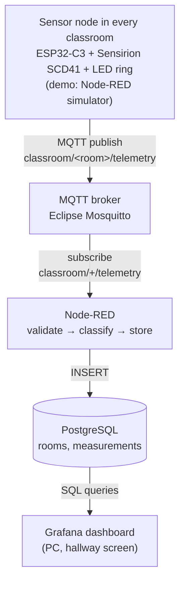

# Smart Classroom Ventilation — Technical Documentation

**Course:** ETEW5E Internet of Things, Czech University of Life Sciences Prague (ZS 2026/27)\
**Team:** Zongyuan Chi, Lijie Luo, Jingyi Liu, Wentao Ma\
**Repository:** https://github.com/witold-andelie/IOT

---

## 1. Name of the solution

**Smart Classroom Ventilation**: a low-cost IoT system that measures CO₂, temperature and
humidity in every classroom and shows a traffic light that tells the teacher when to open the window.

## 2. Motivation

In a closed classroom full of students, CO₂ rises quickly. High CO₂ means poor ventilation:
students get tired and lose concentration. One chamber study (Satish et al., 2012) measured
lower decision-making performance already at 1,000 ppm compared with 600 ppm. Later studies show
mixed results, but the recommendation to keep CO₂ low in schools is widely accepted.

Czech guidance on school ventilation uses **1,500 ppm as the maximum acceptable CO₂ level**
and 800–1,200 ppm as a satisfactory level [2]. Most classrooms are ventilated only by windows,
and nobody in the room can *see* CO₂, so the window usually opens too late.

## 3. Similar solutions

| Solution | Type | What it does | Limitation for a whole school |
|---|---|---|---|
| Aranet4 Home | commercial device, ~€199 | CO₂ display + phone app (Bluetooth) | price per room; no central overview of all rooms without extra paid components |
| Airthings, Netatmo Healthy Home Coach | commercial devices + cloud | CO₂ and other values in a vendor app | vendor cloud, data outside the school, per-device price |
| CO₂-Ampel (DIY, German schools) | open-source traffic light | local LED traffic light | stand-alone, no data storage, no central overview |
| Building management system (BMS) | professional HVAC control | full ventilation control | very expensive; needs mechanical ventilation that most old schools do not have |

### What makes our solution different

- **Central overview of all classrooms** in one dashboard, plus history and statistics
  (e.g. "E101 needs ventilation 50 % of the time"), which helps facility management decide where to invest.
- **Low cost:** about **€51 of hardware per classroom**, all software open source, **no licence fees**.
- **Self-hosted:** the data stays on the university's own server, with no vendor cloud and no lock-in.
- **Standard protocols** (MQTT, SQL), so devices from other vendors can be added later.

## 4. Solution overview

### 4.1 Architecture



| Layer | Component | Role |
|---|---|---|
| Sensor layer | ESP32-C3 + SCD41 (proposed); simulator in Node-RED (demo) | measures CO₂, temperature, humidity; LED shows the status in the room |
| Communication | Wi-Fi + MQTT (Mosquitto) | lightweight publish/subscribe transport |
| Middleware | Node-RED | validates messages, classifies air quality, writes to the database |
| Data layer | PostgreSQL | stores rooms and all measurements |
| Presentation | Grafana | real-time traffic light, history charts, statistics |

### 4.2 Data flow

1. Every sensor node publishes one JSON message to the topic `classroom/<room>/telemetry`:
   ```json
   {"room": "C21", "co2": 1102, "temp": 22.4, "hum": 38.0}
   ```
2. Node-RED subscribes to `classroom/+/telemetry`, checks that all values are numbers and
   classifies the air quality:

   | CO₂ (ppm) | Status | Shown as |
   |---|---|---|
   | < 1,000 | `good` | green, "✓ Good" |
   | 1,000 – 1,400 | `warning` | yellow, "⚠ Ventilate soon" |
   | > 1,400 | `critical` | red, "✕ Ventilate now" |

   The red level starts at 1,400 ppm, so the window is opened **before** the 1,500 ppm limit is reached.
3. The reading and its status are inserted into PostgreSQL.
4. Grafana reads the database and refreshes the dashboard every 10 seconds.

### 4.3 Database model

| Table | Columns | Note |
|---|---|---|
| `rooms` | `id` (e.g. `C21`), `name`, `building`, `capacity` | one row per classroom; `id` is also used in the MQTT topic |
| `measurements` | `id`, `room_id` → `rooms.id`, `co2`, `temp`, `hum`, `status`, `ts` | one row per reading; index on `(room_id, ts)` for fast time queries |

### 4.4 Dashboard


- **Air quality now**: traffic light for each classroom
- **Current readings**: latest values in a table
- **CO₂ concentration**: history with the 1,000 / 1,400 ppm limits
- **Temperature, Relative humidity**: history per room
- **Time needing ventilation**: share of time with CO₂ ≥ 1,000 ppm in the selected period

## 5. Technologies used

### 5.1 Hardware (proposed sensor node, per classroom)

The hardware is part of the proposal. The working demo uses simulated sensors that send exactly
the same MQTT messages, so the real devices can replace the simulator without changes in the rest of the system.

| Part | Model | Why | Approx. price |
|---|---|---|---|
| Microcontroller + Wi-Fi | ESP32-C3 development board | cheap, Wi-Fi built in, large community, MQTT libraries | €6 |
| CO₂ / temperature / humidity sensor | Sensirion SCD41 (module) | real CO₂ measurement (photoacoustic NDIR), 400–5,000 ppm, I²C, automatic self-calibration | €30 |
| Status light | WS2812 LED ring, 8 LEDs | green/yellow/red directly in the classroom | €4 |
| Power | USB 5 V power supply + cable | standard wall socket, < 0.5 W | €6 |
| Enclosure | 3D-printed case with vents + wall mount | protects the electronics, lets air reach the sensor | €5 |
| **Total per classroom** | | | **€51 (≈ 1,275 CZK)** |

Sensor node operation: the SCD41 measures continuously; the ESP32 sends one reading every
60 seconds in production (10 seconds in the demo) and sets the LED colour locally,
so the light keeps working even if the server is unreachable.

### 5.2 Software

| Software | Version | Role | Licence | Cost |
|---|---|---|---|---|
| Eclipse Mosquitto | 2 | MQTT broker | EPL-2.0 / EDL-1.0 | €0 |
| Node-RED | 4.1 | middleware: validation, classification, simulator | Apache-2.0 | €0 |
| node-red-contrib-postgresql | 0.16 | Node-RED → PostgreSQL connector | Apache-2.0 | €0 |
| PostgreSQL | 18 | relational database | PostgreSQL Licence | €0 |
| Grafana OSS | 12.1 | dashboards | AGPL-3.0 | €0 |
| Docker + Docker Compose | — | runs all services with one command | Apache-2.0 | €0 |
| Arduino / ESP-IDF (firmware) | — | ESP32 firmware (production) | open source | €0 |

### 5.3 Deployment

All server components run as Docker containers defined in `docker-compose.yml`.
The whole system starts with:

```bash
cp .env.example .env      # set passwords
docker compose up -d --build
```

The database schema (`db/init.sql`), the Node-RED flows and the Grafana datasource and dashboard
are stored in the repository and loaded automatically, so the system can be re-created on any server.

**Demo vs. production**

| | Demo (this project) | Production |
|---|---|---|
| Sensors | Node-RED simulator, 3 classrooms | ESP32-C3 + SCD41 in every classroom |
| Interval | 10 s (accelerated scenario) | 60 s |
| Server | local computer | university VM or small cloud VM |
| MQTT security | anonymous, localhost only | user/password per device + TLS (port 8883) |
| Grafana access | anonymous read-only, localhost only | university login, HTTPS |

## 6. Expected costs

**Assumptions:** prices are approximate retail prices incl. VAT (November 2026); 1 EUR ≈ 25 CZK.
**Development is not counted as a cost**: it is done by the project team, so only the effort in hours is listed.
**Installation and maintenance are counted** at €25/h (≈ 625 CZK/h, technician / IT staff).
Two scenarios: a **pilot** with 3 classrooms and a **rollout** to 30 classrooms (one faculty building).

### 6.1 Initial costs: hardware and software

| Item | Pilot (3 rooms) | Rollout (30 rooms) |
|---|---|---|
| Sensor nodes (€51 per room) | €153 | €1,530 |
| Software licences | €0 | €0 |
| Server | €0 (existing university VM) | €0 (existing university VM) |
| Installation (0.5 h per room × €25/h) | €38 | €375 |
| **Total** | **€191** | **€1,905** |

### 6.2 Initial costs: development

| Task | Effort |
|---|---|
| Analysis and design | 16 h |
| Infrastructure (Docker, MQTT, PostgreSQL) | 16 h |
| Node-RED flows | 16 h |
| Grafana dashboard | 12 h |
| ESP32 firmware | 24 h |
| Testing and pilot installation | 16 h |
| Documentation and user guide | 20 h |
| **Total** | **120 h, €0** (done by the project team; no wages counted) |

All software used for development is free and open source, so development has no other costs.
The same software serves 3 or 300 classrooms.

### 6.3 Operation for one year: licences, support, sustainability

| Item | Pilot (3 rooms) | Rollout (30 rooms) | Note |
|---|---|---|---|
| Software licences | €0 | €0 | all open source |
| Server | €100 | €100 | small cloud VM (2 vCPU, 4 GB RAM); €0 if the university VM is used |
| Electricity | €3 | €33 | 0.5 W × 8,760 h ≈ 4.4 kWh per node × €0.25/kWh |
| Spare parts reserve | €8 | €77 | 5 % of hardware per year |
| Support and maintenance | €300 | €600 | 1 h / 2 h per month × €25/h: updates, backups, checking devices |
| **Total per year** | **€411** | **€810** | |

### 6.4 Summary

| | Pilot (3 rooms) | Rollout (30 rooms) |
|---|---|---|
| Initial costs (hardware + software + installation) | **€191** (≈ 4,800 CZK) | **€1,905** (≈ 47,600 CZK) |
| Operation, 1 year | **€411** (≈ 10,300 CZK) | **€810** (≈ 20,300 CZK) |
| **Total in the first year** | **€602** (≈ 15,100 CZK) | **€2,715** (≈ 67,900 CZK) |
| Operating cost per classroom per year | €137 | **€27** |

If the existing university VM is used instead of a cloud VM, the yearly cost drops by another €100.

For comparison: 30 commercial Aranet4 Home devices cost about €5,970 for the hardware alone,
and still do not give a central overview of all classrooms.

### 6.5 Sustainability

- **No licence fees and no vendor lock-in.** All components are open source; the school owns the data and the code.
- **Long hardware life.** The SCD41 calibrates itself automatically (rooms are aired regularly,
  so it regularly sees fresh outdoor air); the ESP32 firmware can be updated over Wi-Fi.
- **Low energy use.** About 4.4 kWh per sensor node per year.
- **Easy to extend.** A new classroom only needs a new sensor node and one row in the `rooms` table.
- **Reproducible.** The whole server side is defined as code (Docker Compose, SQL, flow and dashboard files).

## 7. Limitations and possible extensions

- The demo uses simulated sensors; the hardware has not been built.
- Alerts are shown on the dashboard only; e-mail or Microsoft Teams notifications could be added in Node-RED.
- The data could also be used to plan the timetable (e.g. avoid long lessons in rooms that ventilate badly).

## 8. Conclusion

The Smart Classroom Ventilation project demonstrates that a complete, production-ready IoT system for indoor air quality monitoring can be built with **zero licence costs**, open-source software, and commodity hardware — all orchestrated with a single Docker Compose command.

**What the system delivers today:**

- A working data pipeline from sensor to dashboard: simulated sensors publish CO₂, temperature, and humidity every 10 seconds over MQTT; Node-RED validates, classifies (good/warning/critical), and stores readings in PostgreSQL; Grafana visualises everything as real-time traffic lights, history charts, and ventilation-time statistics.
- A hardware design ready to build: ESP32-C3 + Sensirion SCD41 + LED ring at **€51 per classroom**, with firmware architecture that sends identical MQTT payloads so the simulator can be swapped for real devices without changing the backend.
- A self-hosted, standards-based stack: MQTT for transport, SQL for storage, Docker for deployment — no vendor cloud, no lock-in, no recurring fees.
- A cost model that scales: **€51/room hardware + €0 software** versus €199+/room for commercial devices that still lack a central overview.

**Validation:** The running demo proves the full path — Sensor → MQTT → Node-RED → PostgreSQL → Grafana — with live data classified against Czech-recommended thresholds (1,000 / 1,400 ppm) and visualised every 10 seconds, fully automated.

## 9. References

[1] U. Satish, M. J. Mendell, K. Shekhar, T. Hotchi, D. Sullivan, S. Streufert, and W. J. Fisk, "Is CO₂ an indoor pollutant? Direct effects of low-to-moderate CO₂ concentrations on human decision-making performance," *Environmental Health Perspectives*, vol. 120, no. 12, pp. 1671–1677, Dec. 2012. doi: 10.1289/ehp.1104789.

[2] Státní fond životního prostředí ČR, *Metodický pokyn pro návrh větrání škol*, 2023. [Online]. Available: https://www.sfzp.cz/files/documents/storage/2023/07/18/1689667444_Metodick%C3%BD%20pokyn%20pro%20n%C3%A1vrh%20v%C4%9Btr%C3%A1n%C3%AD%20%C5%A1kol.pdf

[3] Sensirion AG, *SCD41 Datasheet: Miniaturized CO₂ Sensor for High-Volume Applications*, 2023. [Online]. Available: https://sensirion.com/media/documents/9E1F6D2D/63B3A9C5/Sensirion_CO2_Sensors_SCD41_Datasheet.pdf

[4] Node-RED Contributors, *Node-RED: Low-code programming for event-driven applications*, 2024. [Online]. Available: https://nodered.org

[5] Eclipse Mosquitto Project, *Eclipse Mosquitto: An open source MQTT broker*, 2024. [Online]. Available: https://mosquitto.org

[6] The PostgreSQL Global Development Group, *PostgreSQL 18 Documentation*, 2024. [Online]. Available: https://www.postgresql.org/docs/

[7] Grafana Labs, *Grafana OSS: Open-source observability platform*, 2024. [Online]. Available: https://grafana.com/docs/grafana/
